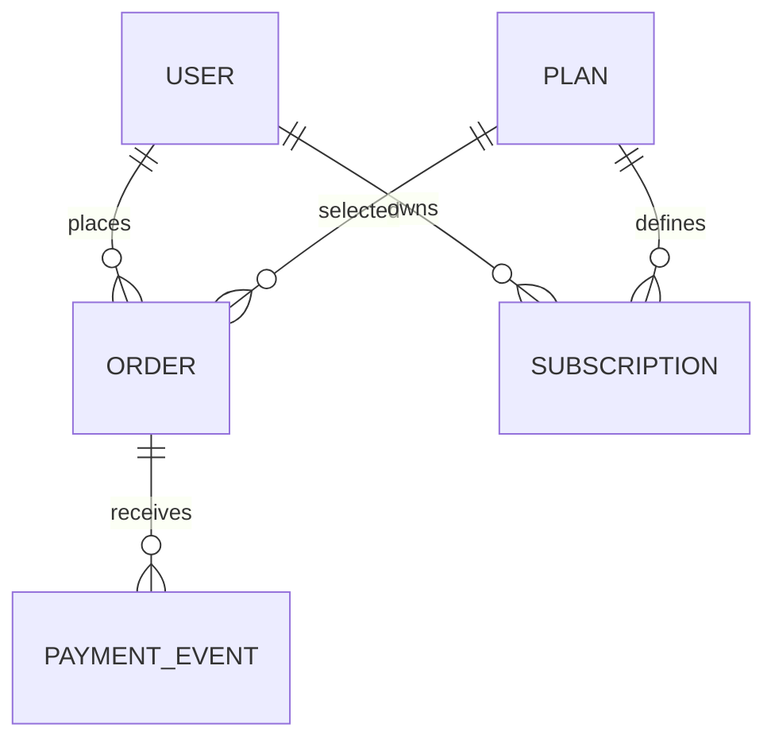

# Модель данных и владение состоянием

## Изменение: один лендинг

Актуальное решение — [requirements](../requirements.md) и [frontend](../frontend/architecture.md): один index.html, секции home → the-app → why-luni → support → plans → checkout → account по PNG 01–07. Старые отдельные страницы/entries относятся к прежней реализации и подлежат объединению. Checkout/Account остаются demo внутри документа. Metadata, canonical и robots задаются всему HTML; отдельный noindex якорю невозможен. Выбор plan обновляет сводку в одном документе, прямая ссылка допустима как `?plan=trial|basic|plus|complete#checkout`. Миграция и её проверки не подтверждены.

Ниже сохранены схемы и инфраструктурные детали; требования об отдельных HTML заменены решением выше.

Статус: проектные схемы. Поля не означают наличие БД или запущенного биллинга. Demo-данные принадлежат первой реализации; серверные сущности — этапу C.

## Контент сайта

| Сущность | Поля | Источник |
|---|---|---|
| Site | brandName, navigation[], defaultLanguage, supportContact? | src/data/site.js |
| Page | pageId, title, description, lang, sections | src/data/pages/<id>.js |
| NavigationItem | id, label, href?, unavailableReason? | Общие данные сайта |
| Asset | src, width, height, alt, decorative, licenseReference | Подготовленные ресурсы / реестр лицензий |
| SupportCategory | id, title, description, action | Данные Support |
| Article (позднее) | id, slug, title, categoryId, body, updatedAt | Согласованный корпус статей |

Если href неизвестен, задаётся unavailableReason; шаблон не превращает его в фиктивную ссылку. Текст статьи не вставляется как произвольный непроверенный HTML.

## Каталог планов

Актуальный состав (заменяет прежние `monthly` / `yearly`):

| `planId` | `displayName` | `durationLabel` | `priceMinor` | `deviceLimit` | `features` |
|---|---|---|---|---|---|
| `trial` | Trial | 5 days | `50` (`0.50`) | `10` | Все возможности |
| `basic` | Basic | 1 month | `700` (`7`) | `5` | 3 сервера |
| `plus` | Plus | 6 months | `2500` (`25`) | `5` | Все сервера + расширение браузера |
| `complete` | Complete | 12 months | `5500` (`55`) | `10` | Все сервера + расширенные + блокировщик рекламы + менеджер паролей + облако данных |

Проектная схема записи каталога:

```json
{
  "planId": "complete",
  "displayName": "Complete",
  "durationLabel": "12 months",
  "priceMinor": 5500,
  "currency": null,
  "deviceLimit": 10,
  "features": [
    "All servers",
    "Extended features",
    "Ad blocker",
    "Password manager",
    "Cloud storage"
  ],
  "available": false,
  "mode": "demo"
}
```

`trial` / `basic` / `plus` / `complete` — стабильные идентификаторы актуального каталога. `available: false` означает отсутствие реальной покупки (не запрет открыть demo-checkout). `deviceLimit` хранит лимит одновременных устройств (`10` для Trial и Complete, `5` для Basic и Plus).

`priceMinor` — целое число минимальных денежных единиц (`50`, `700`, `2500`, `5500`) либо `null` при неизвестной цене. Нулевая цена и неизвестная цена различаются: при `null` отображается «—», не «0». `currency` остаётся `null` до явного подтверждения валюты владельцем продукта (валюта не угадывается). До согласования коммерческих условий вычисленные скидки не показываются.

UI сверяет параметр `plan` с каталогом (`trial`, `basic`, `plus`, `complete`). Сервер этапа C повторно проверяет план, доступность и цену. Браузер никогда не определяет итоговую сумму реального заказа.

## Checkout и оплата

| Сущность | Предложенные поля | Владелец |
|---|---|---|
| CheckoutView | mode, selectedPlan?, summary, availability, message? | Frontend / адаптер |
| CheckoutSession | id, userId?, planId, orderId, status, redirectUrl?, expiresAt | Backend |
| Order | id, userId, planId, amountMinor, currency, status, createdAt | Backend |
| PaymentEvent | provider, eventId, orderId, processingStatus, receivedAt | Backend |

Предложенные состояния заказа: pending → paid / failed / cancelled / expired. Конкретные переходы и поведение позднего success после timeout согласовать с провайдером. Состояние «пользователь закрыл вкладку» не является доказательством отменённого платежа.

Сумма заказа фиксируется сервером при создании. Для изменений каталога предусмотреть version/price reference; созданный заказ не пересчитывается браузером. События провайдера имеют уникальность по provider + eventId. Повторная доставка не создаёт второй заказ или вторую активацию.

## Профиль и подписка

| Сущность | Поля | Ограничения |
|---|---|---|
| User | id, displayName, email, emailVerified, createdAt | Только собственный профиль, проверка на сервере |
| Subscription | id, userId, planId, status, currentPeriodEnd?, cancelAtPeriodEnd | Статусы и правила продления подтверждаются продуктом |
| PaymentMethodSummary | providerReference, brand, last4, expiry? | Только маскированное представление |
| BillingEntry | id, orderId, amountMinor, currency, status, createdAt, receiptUrl? | Доступ только владельцу |

Account demo использует явно синтетические значения; не копировать персональные данные из истории или системного профиля. Платёжные реквизиты, пароль и секреты не являются частью frontend data.

## Связи будущего backend



Это логическая модель, не готовая схема миграций. Тип БД и физические индексы выбираются при реализации. Требуются уникальность обработанного eventId, связь заказа с владельцем, транзакционная согласованность оплаты и подписки.

## Хранение, время и ошибки

- Статические публичные данные версионируются в Git; fixtures отделены от live.
- Выбранный план хранится в URL; email, секреты и платёжные реквизиты в URL не помещаются.
- Даты API — строки UTC ISO 8601; форматирование выполняет UI с явно заданной локалью.
- Известная пустая выборка отличается от ошибки и недоступной функции.
- Ответ API валидируется на границе адаптера, неизвестный статус превращается в безопасное состояние, а не «успех».
- Сроки хранения персональных данных, удаления и журналов определить до live-релиза; архитектура не назначает их произвольными числами.
