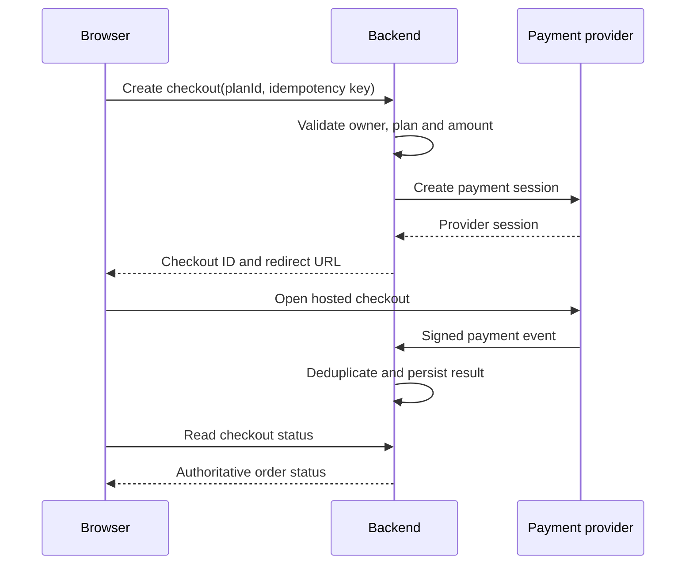

# Проект контрактов API

Статус: предложение для этапа C. Endpoint-ы не существуют; язык backend, авторизация и провайдер не выбраны. Для текущей задачи используются demo-адаптеры. Требования: [backend/requirements](requirements.md); сущности: [data-model](../architecture/data-model.md).

## Принципы

Предлагается HTTP JSON API с префиксом /api/v1 и same-origin публикацией через reverse proxy. Это уменьшает количество отдельных origins; иной вариант фиксируется ADR. Публичная статика остаётся независимо доступной при сбое API.

Денежные поля — целые числа и currency; время — UTC ISO 8601. Идентификаторы непрозрачны для UI. Ошибки не раскрывают stack trace, токены и внутренние реквизиты. Request ID позволяет связать клиентскую ошибку с серверным журналом.

## Предлагаемая поверхность API

| Метод / путь | Вход | Успех | Доступ / особенности |
|---|---|---|---|
| GET /plans | — | Каталог доступных планов | Публичный; актуальность цены проверяется при checkout |
| GET /me | — | Профиль | Сессия; чужой userId не принимается |
| PATCH /me | Разрешённые поля профиля | Обновлённый профиль | Сессия; смена email требует отдельной проверки |
| POST /session/logout | — | 204 | Завершение сессии; клиент очищает пользовательское состояние |
| GET /subscription | — | Подписка либо null | Сессия |
| GET /billing/history | cursor?, limit? | items[], nextCursor? | Сессия, ограниченная пагинация |
| POST /checkout/sessions | planId | id, status, redirectUrl?, expiresAt | Авторизованный либо отдельно согласованный guest-flow; idempotency key |
| GET /checkout/sessions/{id} | — | Серверный статус и сводка | Только владелец; защита от перебора |
| POST /subscription/cancel | Подтверждённое действие | Новое состояние подписки | Сессия; точные последствия определяет продукт |
| POST /webhooks/payments/{provider} | Событие провайдера | Ответ по контракту провайдера | Проверка подписи; не браузерная сессия |

Маршруты входа/регистрации не выдумываются до D05. Поиск/обращения Support добавляются только при выборе API вместо статического корпуса. Все пути таблицы относительны к /api/v1.

## Ответы и ошибки

Предлагаемый конверт успеха: data и requestId; списки дополнительно содержат nextCursor. Для 204 тела нет.

```json
{
  "error": {
    "code": "PLAN_UNAVAILABLE",
    "message": "This plan is currently unavailable.",
    "retryable": false,
    "fieldErrors": {}
  },
  "requestId": "example-request"
}
```

| HTTP | Значение для UI |
|---|---|
| 400 / 422 | Некорректный запрос / ошибки полей; показать рядом с полями |
| 401 | Нет действующей сессии; предложить вход, не показать demo-профиль |
| 403 | Действие запрещено |
| 404 | Ресурс не найден; не раскрывать чужие данные |
| 409 | Конфликт состояния или повторное действие с другим содержимым |
| 429 | Ограничение частоты; учитывать Retry-After, если передан |
| 5xx / timeout | Временная ошибка; не заявлять об успешной операции |

Автоповторы безопасных чтений ограничены. Мутации не повторяются слепо. Повтор создания checkout допускается с тем же idempotency key и тем же телом; сервер возвращает первоначальный результат. Срок действия ключа фиксируется в окончательном контракте.

## Сценарий оплаты



Возврат пользователя может случиться раньше webhook: UI показывает pending и ограниченно повторяет чтение. При потере события требуется серверная сверка с провайдером, а не ручное превращение pending в paid. Подписка обновляется атомарно или через устойчивую повторяемую обработку; выбранный вариант описывается при проектировании backend.

## Границы безопасности

Для cookie-сессии проектировать HttpOnly/Secure, политику SameSite и CSRF-защиту изменяющих запросов. Если выбирается другая схема, описать её угрозы и жизненный цикл. CORS не заменяет авторизацию. Сервер проверяет владельца каждого заказа/подписки.

Подписи webhook проверяются по исходному телу согласно будущему провайдеру, ключи находятся только на сервере. Логи маскируют персональные данные. Redirect URL разрешён только для доверенных платёжных origins и не берётся без проверки из пользовательского ввода.

## Что нужно до реализации

Согласовать D03–D05, окончательные схемы и статусы, сессии, idempotency, лимиты, таймауты, webhook-подпись, правила хранения и версионирование. Затем создать OpenAPI-файл и контрактные тесты. Этот Markdown не подменяет окончательный машинный контракт.
