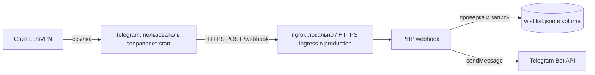

# Backend вишлиста LuniVPN — требования к реализации

Статус: локальный MVP реализован; фактические результаты и оставшиеся проверки — в [status.md](status.md). Основа — изученные исходники Nordel: tg-bot/common.php, webhook.php, webhook-admin.php, docker/bot.Dockerfile, docker/site.Dockerfile, docker/ngrok.yml и compose.yaml. Допускается копировать техническую реализацию с адаптацией бренда и проверкой по этому документу.

Вишлист не зависит от проектирования Account/Billing API. Он не создаёт аккаунт LuniVPN, платную подписку или VPN-доступ. Реализация — [task-012](../task-012.md); запуск — [docker-compose.md](docker-compose.md); приёмка — [wishlist-validation.md](wishlist-validation.md).

## 1. Пользовательский сценарий

1. Посетитель открывает действие «Вишлист» на сайте.
2. Сайт объясняет, что приложение ещё не запущено и регистрация выполняется в Telegram.
3. Пользователь переходит по согласованной ссылке https://t.me/<bot_username>.
4. Пользователь самостоятельно запускает бота командой /start.
5. Бот сохраняет или обновляет пользователя и только после успешной записи отправляет приветствие.
6. Повторный /start обновляет запись без дубликата и снова отвечает пользователю.

Клик на сайте не означает добавление в вишлист. Frontend не отправляет Telegram ID и не вызывает Telegram Bot API. Токен не попадает в браузер. Получение ботом /start — единственное основание записи в первом этапе.

Предлагаемый текст приветствия: «Вы добавлены в вишлист LuniVPN. Приложение ещё не запущено. Здесь мы сообщим о запуске». Текст хранится централизованно; язык и редакцию подтвердить до публичного запуска. Автоматические рассылки в эту задачу не входят.

## 2. Архитектура



| Компонент | Ответственность |
|---|---|
| site | Статическая сборка сайта, Nginx, ссылка/окно вишлиста |
| bot | Приём webhook, проверка секрета, обработка /start, запись, ответ |
| ngrok | Локальный HTTPS-туннель только к bot:8080 |
| wishlist volume | Постоянное хранилище отдельно от образа и каталога сайта |
| webhook-admin | Явная регистрация, просмотр и удаление webhook |
| bot.php | Альтернативный polling; никогда одновременно с webhook |

Основной режим — webhook. Локальный стенд: один процесс PHP HTTP-server, один контейнер bot, max_connections=1 при регистрации webhook. JSON рассчитан на небольшой вишлист и один узел. Горизонтальное масштабирование требует отдельного решения с БД.

## 3. Технологии и файлы

Базу Nordel можно использовать без переписывания на Node. Node нужен сборке сайта; backend выполняется PHP. Composer-зависимости для исходной реализации не нужны: JSON, файловая блокировка и HTTPS stream transport реализованы средствами PHP. В образе проверить HTTPS wrapper, сертификаты, JSON и 64-битные целые числа для Telegram ID.

| Планируемый файл | Назначение / адаптация |
|---|---|
| tg-bot/common.php | Конфигурация, вызовы Telegram, сохранение пользователя, /start; заменить текст бренда |
| tg-bot/webhook.php | Строгая маршрутизация, размер тела, проверка секрета, HTTP-ответы |
| tg-bot/webhook-admin.php | set/info/delete; без вывода токенов и секретов |
| tg-bot/bot.php | Polling, если переносится; проверить offset и обработку ошибок |
| tg-bot/README.md | Фактические команды и ограничения после реализации |
| docker/bot.Dockerfile | База PHP 8.4 CLI для локального стенда, непривилегированный пользователь |
| docker/site.Dockerfile | Сборка npm ci → build/prod; Nginx с готовыми файлами |
| docker/ngrok.yml | Панель ngrok внутри контейнера; loopback-публикация снаружи |
| compose.yaml | site, bot, ngrok, volume wishlist |
| .env.example | Пустые секреты и пояснения |
| .gitignore / .dockerignore | Исключить .env, данные, backups, node_modules и ненужные файлы |
| tests/backend/ | Изолированные HTTP/storage-тесты без рабочего бота |
| src/data/site.js | Публичные wishlist.telegramUrl и тексты |
| src/modules/wishlist.js | Доступное окно, если используется модальный вариант |
| src/templates/partials/shared/wishlist.hbs | Разметка окна и перехода |

Не копировать .env, Telegram-пользователей, резервные копии, Git/IDE-настройки и объекты volume Nordel. Имена сервиса/Compose-проекта и данные LuniVPN изолировать от Nordel; не использовать чужой external volume.

## 4. Требования с ID

| ID | Требование | Критерий |
|---|---|---|
| WL-01 | Рабочая ссылка сайта на собственного бота | Сайт → нужный бот → /start |
| WL-02 | Обработка /start, /start с аргументом и адресованной команды | Запись и приветствие; неизвестные команды безопасно игнорируются |
| WL-03 | Уникальность telegramId | Повторный /start сохраняет одну запись |
| WL-04 | createdAt неизменяем, lastStartAt обновляется | Сравнение до/после |
| WL-05 | Секрет webhook проверяется до обработки тела | Нет секрета / неверный → 403, без записи и sendMessage |
| WL-06 | Ограничение тела 65536 байт и проверка JSON/update_id | 413/400; некорректный ввод не меняет данные |
| WL-07 | Запись под lock и атомарная замена | Нет потери пользователей при одновременных сохранениях |
| WL-08 | Повреждённый JSON не затирается | Ошибка и исходный файл сохранён |
| WL-09 | Данные переживают пересоздание контейнера | Тот же volume и те же записи |
| WL-10 | Ошибка сохранения/Telegram не выдаётся за успех | 500 и безопасный журнал |
| WL-11 | Исходники, JSON, секреты недоступны по HTTP | Неизвестные пути → 404; данные вне web root |
| WL-12 | Регистрация webhook выполняется явно | set/info/delete; без регистрации на старте контейнера |
| WL-13 | Backup и восстановление проверены | Изолированное восстановление валидного JSON |
| WL-14 | Нет ложной регистрации в UI | Переход не показывает «вы добавлены»; пустой URL объяснён |

## 5. Контракт webhook

| Метод / путь | Условие | Результат |
|---|---|---|
| GET /health | Валидная конфигурация процесса | 200, ok |
| POST /webhook | Нет/неверный X-Telegram-Bot-Api-Secret-Token | 403 |
| POST /webhook | Тело более 65536 байт | 413 |
| POST /webhook | Некорректный JSON, не объект, нецелый update_id | 400 |
| POST /webhook | Корректное нерелевантное событие | 200 без записи/ответа |
| POST /webhook | Корректный /start | Запись, sendMessage, затем 200 |
| POST /webhook | Сбой хранения или Telegram | 500, без раскрытия внутренних данных |
| Прочие пути/методы | Включая GET /webhook, /common.php, /data/wishlist.json | 404 |

В Nordel /health проверяет процесс с валидными переменными, но не доступность Telegram, корректность токена или возможность записи. Не считать его сквозным health-check.

Сравнивать секрет безопасной функцией сравнения. Принимать только ожидаемую структуру message/from/chat и целочисленные идентификаторы. Некорректное содержимое релевантной команды в Nordel может приводить к 500; при переносе явно разделить невалидное входящее событие (400) и инфраструктурный сбой (500), покрыть тестом.

Для LuniVPN обрабатывать регистрацию в личном чате с ботом; сообщения групп не должны автоматически регистрировать участников. Это уточнение относительно Nordel, где фильтра по private chat нет. Проверить распознавание /start: /starter не считается командой, аргумент команды не исполняется.

## 6. Хранилище

Файл WISHLIST_FILE, в Compose /data/wishlist.json. Корень JSON — массив объектов:

```json
[
  {
    "telegramId": 123456789,
    "username": "example_user",
    "firstName": "Example",
    "lastName": null,
    "createdAt": "2026-01-01T00:00:00+00:00",
    "lastStartAt": "2026-01-01T00:00:00+00:00"
  }
]
```

Пример синтетический. username/firstName/lastName допускают null. Ключ уникальности — telegramId, не username. Время генерируется сервером в UTC. При повторе обновляются имена и lastStartAt, createdAt сохраняется.

Алгоритм: создать каталог при необходимости → открыть отдельный .lock → эксклюзивный flock → прочитать и проверить массив/записи → upsert → записать временный файл в том же каталоге → атомарно rename → очистить временный файл при ошибке → снять lock. Все читатели/писатели, изменяющие данные, соблюдают этот протокол. Ошибка декодирования не трактуется как пустой список.

Файл доступен только пользователю сервиса и уполномоченному оператору. Не выводить полный JSON с реальными пользователями в CI-отчёты. В backup также находятся персональные данные; доступ, срок хранения и удаление определить до публичного запуска.

## 7. Повторная доставка и отказы

Уникальность пользователя не равна exactly-once обработке события. Базовая версия Nordel не хранит update_id; повторное событие может повторить приветствие. Это допустимое документированное ограничение первой реализации, не обещание отсутствия повторных сообщений.

Если запись успешна, а sendMessage завершился ошибкой, запись остаётся; ответ webhook — 500. При повторе запись обновляется и отправка повторяется. Не откатывать сохранённого пользователя и не создавать дубликат. Timeout исходящего запроса должен быть конечным (в Nordel 15 секунд), ошибки без токена/URL с токеном в логах.

История событий, очередь рассылок и outbox — отдельное развитие. Не подавлять ошибку отправки сохранением «успешного update_id», иначе приветствие может потеряться.

## 8. Frontend и открытые значения

Вишлист включён в объём backend. Точное место CTA согласуется с task-003: сохранить существующий demo-путь Get Luni → Plans → Checkout, а действие вишлиста предоставить отдельно либо явно согласовать замену. Нельзя молча перенаправить Choose plan в Telegram.

Для модального окна: заголовок, пояснение, ссылка, закрытие, Escape, удержание и восстановление фокуса. Если URL не задан, действие недоступно с объяснением; это не проходит сквозную приёмку WL-01. Обычная ссылка может работать без JS.

До реального прогона нужны собственные bot username/token, webhook secret и ngrok authtoken; секреты задаются локально/на сервере, не в чате и не в документах. До production нужны домен webhook, размещение, тексты и правила обработки данных. Эти значения не блокируют перенос кода и изолированные тесты.
